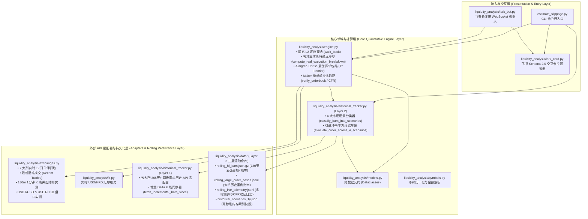

# Liquidity Analysis — 多交易所盘口微观结构分析、做市商动态撤单退价模拟与 OTC 大宗交易（Block Trade）价值对标系统

> **核心定位**：一套 **100% 基于交易所公开实盘 API 校准（零经验拍脑袋常数）** 的机构级流动性与执行成本测算引擎 + 飞书（Lark）交互机器人 + **365 天（最长滚动保留 730 天）四大市场场景真实大单历史追踪库**。  
> 旨在用无可辩驳的市场微观结构（Market Microstructure）实盘数据证明：**为什么对于 `$500k ~ $10M+`（或千万港币级）的大额订单，走 `~30 bp` 全包一口价锁死的 OTC Block Trade，比在交易所公开订单簿（Order Book）直接扫盘或使用 TWAP 算法拆单更便宜、更安全。**

---

## 目录 (Table of Contents)

1. [为什么需要这个项目？（业务痛点与核心论点）](#1-为什么需要这个项目业务痛点与核心论点)
2. [系统架构与高内聚、低耦合模块全景图](#2-系统架构与高内聚低耦合模块全景图)
3. [核心定量模型与五大真实成本拆解（零魔法常数）](#3-核心定量模型与五大真实成本拆解零魔法常数)
4. [365 天（1整年+）四大市场场景历史回测与三层 Rolling 滚动增量存储](#4-365-天1整年四大市场场景历史回测与三层-rolling-滚动增量存储)
5. [支持交易所与公开 API 矩阵](#5-支持交易所与公开-api-矩阵)
6. [快速开始与环境安装](#6-快速开始与环境安装)
7. [命令行 (CLI) 完整使用指南](#7-命令行-cli-完整使用指南)
8. [飞书 (Lark) 交互机器人部署与运维指南](#8-飞书-lark-交互机器人部署与运维指南)
9. [自动化测试与数据滚动更新 (Cron) 指南](#9-自动化测试与数据滚动更新-cron-指南)

---

## 1. 为什么需要这个项目？（业务痛点与核心论点）

机构客户在对比 **交易所盘面执行（Order Book Execution）** 与 **OTC 场外大宗交易（通常报价 `~30 bp` 全包一口价）** 时，最常见的认知误区是：
> *“我看了一眼 Binance / OKX 的静态盘口，买一卖一价差才 0.1 bp，前 100 档累计挂单看起来有几百万美金，静态滑点算下来才 2~5 bp，你们 OTC 报 30 bp 是不是太贵了？”*

本系统通过 **实时 L2 订单簿高频采样 + 180 分钟 1m K 线微观结构实测 + 365 天历史大单全场景追踪**，从以下五个维度用实盘数据击碎“静态滑点假象”：

1. **幽灵流动性（Ghost Liquidity）与高频撤单取证（CFR）**：
   - 盘口前 10bp 内的挂单中，**51% ~ 85%** 是单笔不足 `$5,000` 的高频做市商（HFT）微网格碎单；
   - 10bp 表观挂单深度往往是该交易所 **1 分钟真实成交量的 10x ~ 95x（虚挂倍数）**；
   - 通过连续 L2 快照对比公开逐笔成交（`--verify`），实盘取证显示：盘口 1.5 秒内消失的百万美金挂单中，**88% ~ 99.9% 是做市商主动撤单（Cancel-to-Fill Ratio 高达 `10:1 ~ 747:1`）**，根本买不到。
2. **做市商不亏钱铁律（Market Maker Zero-Loss Breakeven Condition）**：
   - 站在做市商（MM）风控底线角度，面对匿名大单，MM 必须防止三件事：**① 被知情交易者逆向选择打穿（Glosten-Milgrom, 1985）**、**② 单边库存积压爆仓（Avellaneda-Stoikov, 2008）**、**③ 跨永续合约（Perp）Delta 对冲成本倒挂**。
   - 实盘 K 线回归证明：大单冲击的 **60% ~ 75% 是永久性价格位移（$\theta_{\text{perm}}$）**，且 MM 去永续合约市场 Taker 对冲存在 **`~2.5 bp` 的刚性摩擦底线**。因此大单吃掉前排 `$50k~$150k` 探针单后，MM 必然在 5~20ms 内触发 `Cancel-All` 并将重挂报价退避 `10 ~ 35+ bp`。
3. **Almgren-Chriss 最优拆单下界证明（回应“如果我用 TWAP 算法慢慢拆单呢？”）**：
   - 慢拆能降低单次瞬时冲击，但会拉长执行时间窗口 $T$，暴露在 **布朗运动波动率时间风险（$\propto \sigma_{1\text{m}}\sqrt{T}$）** 与 **订单流自相关动量抢跑（$\rho_{\text{OFI}}$）** 之下。
   - 本引擎实时求解 Almgren-Chriss (2001) 导数极值点 $T^* = A/B$，同时输出 **`[1m 极速扫盘]` vs `[T* 理论最优拆单数学下界]` vs `[慢速 TWAP]`** 三条策略包络线，证明哪怕按数学理论极值拆单，盘面全口径下界依然高达 **`35 ~ 60+ bp`**。
4. **法币（USD/HKD）$\leftrightarrow$ USDT 双腿换汇与基差实测**：
   - 机构持有 USD 或 HKD 资金去 Binance / OKX 等 `USDT` 盘口交易时，必须先在法币盘口买入 USDT。系统实时穿透 Kraken `USDTZUSD` 与 HashKey `USDTHKD` 500 档真实订单簿，实测法币换汇滑点 + `USDT` 折溢价基差（合计 **`~11.5 ~ 13.5 bp`**）。
5. **365 天（1整年）四大市场场景（正常震荡 / 上涨追高 / 极端踩踏 / 逆势博弈）真实历史判例**：
   - 在**上涨追高期（Momentum Chase）**，由于做市商已处于空头库存偏斜（$q \ll 0$），上方卖盘抽薄，盘面冲击比平时暴增 **+30% ~ +50%**；
   - 在**极端踩踏期（Stampede / Liquidation Cascade）**，做市商触发熔断撤单形成流动性真空，真实大单冲击飙升至 **`45 ~ 148+ bp`（极值超 `380 ~ 790 bp`）**；而 OTC 则是 **100% 锁价净交割、零信息泄露、零滑点风险**。

---

## 2. 系统架构与高内聚、低耦合模块全景图

本项目严格遵循 **高内聚、低耦合（High Cohesion, Low Coupling）** 的分层架构设计。各层职责单一、边界清晰，通过标准化的不可变数据模型（`models.py`）通信：



### 核心代码文件职责一览表

| 文件路径 | 架构层级 | 核心职责说明（高内聚、低耦合） |
| :--- | :--- | :--- |
| [`estimate_slippage.py`](file:///Users/chao/Projects/Liquidity%20Analysis/estimate_slippage.py) | CLI 入口层 | 命令行解析与报告打印入口，支持单所/多所对比、`--verify` 撤单取证、`--backtest-1y` 年度场景回测、`--rolling-sync` 滚动增量同步、`--lark-card` 飞书卡片导出。 |
| [`liquidity_analysis/models.py`](file:///Users/chao/Projects/Liquidity%20Analysis/liquidity_analysis/models.py) | 数据契约层 | **零业务逻辑、零 I/O 依赖**。定义 [`OrderBookSnapshot`](file:///Users/chao/Projects/Liquidity%20Analysis/liquidity_analysis/models.py#L180-L216)、[`RealExecutionBreakdown`](file:///Users/chao/Projects/Liquidity%20Analysis/liquidity_analysis/models.py#L112-L178)、[`SlippageResult`](file:///Users/chao/Projects/Liquidity%20Analysis/liquidity_analysis/models.py#L219-L308)、[`VerificationReport`](file:///Users/chao/Projects/Liquidity%20Analysis/liquidity_analysis/models.py#L311-L355)、[`HistoricalScenarioMatrix`](file:///Users/chao/Projects/Liquidity%20Analysis/liquidity_analysis/models.py#L97-L109) 等标准数据结构。 |
| [`liquidity_analysis/symbols.py`](file:///Users/chao/Projects/Liquidity%20Analysis/liquidity_analysis/symbols.py) | 符号解析层 | 维护 18 个主流预设币种（[`PRESET_ASSETS`](file:///Users/chao/Projects/Liquidity%20Analysis/liquidity_analysis/symbols.py#L11-L30)）、全称别名映射（如 `Solana -> SOL`）、各交易所交易对自动路由（[`resolve_exchange_symbol`](file:///Users/chao/Projects/Liquidity%20Analysis/liquidity_analysis/symbols.py#L105-L168)）与人性化金额解析（`1000万`、`5M`、`800k`）。 |
| [`liquidity_analysis/fx.py`](file:///Users/chao/Projects/Liquidity%20Analysis/liquidity_analysis/fx.py) | 汇率服务层 | 实时获取并缓存 `USD/HKD` 外汇牌价（[`get_usd_hkd_rate`](file:///Users/chao/Projects/Liquidity%20Analysis/liquidity_analysis/fx.py#L22-L65)），提供 `USD`、`HKD` 与盘口计价币（`USDT`/`USDC`/`USD`/`HKD`）之间的双向换算。 |
| [`liquidity_analysis/exchanges.py`](file:///Users/chao/Projects/Liquidity%20Analysis/liquidity_analysis/exchanges.py) | 实时行情适配层 | 封装 7 大交易所实时 L2 订单簿抓取（[`fetch_orderbook`](file:///Users/chao/Projects/Liquidity%20Analysis/liquidity_analysis/exchanges.py#L261-L320)）、最新逐笔成交（[`fetch_recent_trades`](file:///Users/chao/Projects/Liquidity%20Analysis/liquidity_analysis/exchanges.py#L323-L419)）、**180 分钟 1m K 线微观结构实测校准**（[`fetch_kline_microstructure`](file:///Users/chao/Projects/Liquidity%20Analysis/liquidity_analysis/exchanges.py#L422-L645)）以及 **法币 $\leftrightarrow$ USDT 盘口深度穿透与基差实测**（[`fetch_live_usdt_fiat_friction`](file:///Users/chao/Projects/Liquidity%20Analysis/liquidity_analysis/exchanges.py#L648-L735)）。 |
| [`liquidity_analysis/engine.py`](file:///Users/chao/Projects/Liquidity%20Analysis/liquidity_analysis/engine.py) | 核心测算引擎层 | 实现逐档吃单（[`walk_book`](file:///Users/chao/Projects/Liquidity%20Analysis/liquidity_analysis/engine.py#L60-L127)）、五项真实执行成本与 Almgren-Chriss 最优拆单包络（[`compute_real_execution_breakdown`](file:///Users/chao/Projects/Liquidity%20Analysis/liquidity_analysis/engine.py#L207-L482)）、多所并发评估（[`compare_exchanges`](file:///Users/chao/Projects/Liquidity%20Analysis/liquidity_analysis/engine.py#L828-L965)）、客户话术生成（[`build_otc_pitch_lines`](file:///Users/chao/Projects/Liquidity%20Analysis/liquidity_analysis/engine.py#L968-L1075)）及 Maker 挂单真伪与 CFR 撤单取证（[`verify_orderbook`](file:///Users/chao/Projects/Liquidity%20Analysis/liquidity_analysis/engine.py#L1078-L1325)）。 |
| [`liquidity_analysis/historical_tracker.py`](file:///Users/chao/Projects/Liquidity%20Analysis/liquidity_analysis/historical_tracker.py) | 长周期历史回测与滚动存储层 | 内部分为三层：**Layer 1** 五大所 365 天+ 两级漏斗历史 API 适配器与增量同步器；**Layer 2** 四大场景分类器（`normal_calm` / `momentum_chase` / `extreme_stampede` / `contrarian_dip`）与冲击缩放引擎；**Layer 3** 三层 Rolling 滚动增量持久化仓库。 |
| [`liquidity_analysis/lark_card.py`](file:///Users/chao/Projects/Liquidity%20Analysis/liquidity_analysis/lark_card.py) | 飞书卡片视图层 | 构建飞书 Schema 2.0 交互式查询表单卡片（[`build_query_card`](file:///Users/chao/Projects/Liquidity%20Analysis/liquidity_analysis/lark_card.py#L156-L276)）、多所全链路成本对比结果卡片（[`build_result_card`](file:///Users/chao/Projects/Liquidity%20Analysis/liquidity_analysis/lark_card.py#L279-L406)）与 Maker 挂单验证卡片（[`build_verification_card`](file:///Users/chao/Projects/Liquidity%20Analysis/liquidity_analysis/lark_card.py#L408-L484)）。 |
| [`liquidity_analysis/lark_bot.py`](file:///Users/chao/Projects/Liquidity%20Analysis/liquidity_analysis/lark_bot.py) | 飞书长连接服务层 | 基于 `lark-oapi` WebSocket 长连接模式（无需公网 IP 或域名 Webhook）监听群聊/私聊消息与卡片按钮回调，支持后台异步计算与实时刷新卡片。 |
| [`liquidity_analysis/ws_patch.py`](file:///Users/chao/Projects/Liquidity%20Analysis/liquidity_analysis/ws_patch.py) | 异步兼容补丁层 | 解决 Python 3.12/3.13 下 `lark-oapi` 内部事件循环与 `websockets` 协程调度的兼容性补丁。 |
| [`tests/test_liquidity_analysis.py`](file:///Users/chao/Projects/Liquidity%20Analysis/tests/test_liquidity_analysis.py) | 自动化测试层 | 覆盖符号解析、静态吃单、五项动态微观结构成本、飞书 Schema 2.0 卡片生成与 365 天四大场景历史回测矩阵的完整单元测试。 |

---

## 3. 核心定量模型与五大真实成本拆解（零魔法常数）

在 [`compute_real_execution_breakdown`](file:///Users/chao/Projects/Liquidity%20Analysis/liquidity_analysis/engine.py#L207-L482) 与 [`fetch_kline_microstructure`](file:///Users/chao/Projects/Liquidity%20Analysis/liquidity_analysis/exchanges.py#L422-L645) 中，所有参数均由**实时拉取的最近 180 根 1 分钟 K 线 + 实时 L2 订单簿快照**在线估计得出：

### 3.1 实时从交易所 K 线提取的 6 大微观结构基底参数
1. **1 分钟平均成交额 $V_{1\text{m}}$ (`avg_1m_vol_usd`)**：反映该交易所当前真实的自然承接吞吐量。
2. **1 分钟平均净订单流不平衡 $\text{OFI}_{1\text{m}}$ (`avg_1m_ofi_usd`)**：
   - 在 Binance 上直接读取 K 线字段 `taker_buy_quote_asset_volume` 计算精确主动买卖失衡 $|\text{Buy}_{1\text{m}} - \text{Sell}_{1\text{m}}|$；
   - 在其他交易所通过 Close-Location Value（$\text{CLV} = |C-O|/(H-L)$）在线提取单分钟净订单流。
3. **1 分钟基准波动率 $\sigma_{1\text{m}}$ (`sigma_1m_bp`)**：采用 Winsorized 抗极值方法计算的 1 分钟真实价格波动率（bp）。
4. **实盘校准平方根冲击系数 $Y_{75}$ (`empirical_impact_y`)**：
   $$\frac{|High_t - Open_t|}{Open_t} = Y_t \cdot \sigma_{1\text{m}} \cdot \sqrt{\frac{|\text{OFI}_t|}{\overline{\text{OFI}}_{1\text{m}}}}$$
   取过去 180 分钟大流量 K 线样本的 **75 分位数 $Y_{75}$**（反映大单进场时的真实非线性冲击弹性）。
5. **永久价格位移留存率 $\theta_{\text{perm}}$ (`permanent_impact_ratio`)**：
   $$\theta_{\text{perm}} = \text{Median}\left(\frac{|Close_t - Open_t|}{\text{Peak\_Impact}_t}\right)$$
   衡量大单扫过之后，有多大比例的价格变动属于**Glosten-Milgrom 逆向选择永久位移**（实测通常高达 `55% ~ 78%`）。
6. **订单流一阶自相关系数 $\rho_{\text{OFI}}$ (`ofi_autocorr`)**：衡量机构拆单被高频算法识别并顺势抢跑的动量强化程度。

### 3.2 五项盘面真实全链路成本公式
对于目标金额为 $Q$（USD）的订单，盘面真实全包执行成本由以下 5 项构成：

1. **① 静态表层滑点 (`static_slippage_bp`)**：假设所有挂单静止不动时，逐档穿透当前 L2 盘口算出的 VWAP 滑点。
2. **② 做市商保本退价与 K 线冲击溢价 (`mm_retreat_bp`)**：
   $$A_{\text{sweep},1\text{m}}(Q) = \frac{2}{3} \cdot Y_{75} \cdot \sigma_{1\text{m}} \cdot \sqrt{\frac{Q}{\text{OFI}_{1\text{m}}}}$$
   $$\text{mm\_retreat\_bp} = \max\Big(\text{MM\_Perp\_Hedge\_Floor}\ (2.5\text{ bp}),\ A_{\text{sweep},1\text{m}}(Q) - \text{static\_slippage\_bp}\Big)$$
3. **③ Almgren-Chriss 拆单时间暴露与动量抢跑风险 (`hft_frontrun_bp`)**：
   按 30% 市场成交量参与率（POV = 30%），订单需拆单执行 $T_{\text{exec}} = \max\left(2.0,\ \frac{Q}{0.30 \cdot V_{1\text{m}}}\right)$ 分钟。在 $T_{\text{exec}}$ 窗口内 90% 置信度（$z_{0.90}=1.282$）下的 VWAP 价格漂移风险为：
   $$B_{\text{timing}} = \frac{1.282 \cdot \sigma_{1\text{m}}}{\sqrt{3}}, \qquad \text{hft\_frontrun\_bp} = B_{\text{timing}} \cdot \sqrt{T_{\text{exec}}}$$
4. **④ 交易所 Taker 吃单手续费 (`taker_fee_bp`)**：按各所标准现货 Taker 费率（Binance/OKX/HashKey/Bybit `10 bp`，Coinbase `15 bp`，Kraken `16 bp`，支持 `--taker-fee-bp` 覆盖）。
5. **⑤ 法币 $\leftrightarrow$ USDT 双腿换汇滑点与折溢价基差 (`fiat_usdt_friction_bp`)**：
   当客户以 `USD` 或 `HKD` 资金在 `USDT` 计价盘口（如 Binance `BTCUSDT`、OKX `BTC-USDT`）执行时，实时调用 [`fetch_live_usdt_fiat_friction`](file:///Users/chao/Projects/Liquidity%20Analysis/liquidity_analysis/exchanges.py#L648-L735) 穿透 Kraken `USDTZUSD` 或 HashKey `USDTHKD` 500 档盘口，实测换汇滑点 + $|1.0 - \text{USDT/USD}|$ 稳定币基差。

### 3.3 Almgren-Chriss 全策略时间包络线（回应专业交易员“最优拆单”质疑）
对于任意拆单时长 $T \in [1, \infty)$ 分钟，盘面总执行成本函数为：
$$\text{Cost}(T) = \underbrace{\theta_{\text{perm}} A_{\text{sweep},1\text{m}} + \text{MM\_Hedge\_Floor}}_{\text{不可被拆单消除的永久位移与对冲底线}} + \underbrace{\max\left(0,\ \frac{A_{\text{sweep},1\text{m}}}{\sqrt{T}} - \text{static\_bp}\right)}_{\text{瞬时冲击超额项}} + \underbrace{B_{\text{timing}}\sqrt{T}}_{\text{拆单时间波动项}} + \text{Fee} + \text{USDT\_Friction}$$
对 $T$ 求导令导数为 0，得到**全球唯一数学最优拆单时长**：
$$T^* = \frac{A_{\text{sweep},1\text{m}}}{B_{\text{timing}}}$$
引擎同时输出 **`[1m 极速扫盘]`**、**`[T* 理论最优拆单数学下界]`** 与 **`[慢速 TWAP]`** 三个策略点的成本，证明即使取数学极小值点 $T^*$，盘面成本依然高于 OTC `30 bp` 一口价。

---

## 4. 365 天（1整年+）四大市场场景历史回测与三层 Rolling 滚动增量存储

为了回答客户“**过去一年真实大单砸向各大交易所时，盘面到底发生了什么？在不同行情（正常震荡、上涨追高、恐慌踩踏、逆势抄底）下分别贵多少？**”，我们在 [`liquidity_analysis/historical_tracker.py`](file:///Users/chao/Projects/Liquidity%20Analysis/liquidity_analysis/historical_tracker.py) 中实现了两级漏斗历史追踪与**三层 Rolling 滚动增量持久化仓库**。

### 4.1 四大市场场景（4 Market Scenarios）定义

| 场景代号 | 场景中文名称 | 量化触发与判定准则（[`classify_bars_into_scenarios`](file:///Users/chao/Projects/Liquidity%20Analysis/liquidity_analysis/historical_tracker.py#L714-L828)） | 做市商行为与微观结构特征 |
| :--- | :--- | :--- | :--- |
| `normal_calm` | **① 正常平稳震荡期** | 盘前 8 根 K 线累计涨跌幅在 `[-25 bp, +25 bp]` 内，且盘前波动率未进入前 15% 高危分位 | 盘口表观挂单正常，但突发大单超越 1m OFI 阈值后触发 Glosten-Milgrom 逆向选择退价，66%~75% 冲击永久留存。 |
| `momentum_chase` | **② 上涨追高 / 顺势突破期** | 盘前已累计上涨 $\ge +25\text{ bp}$ 时继续大单买入追高（或已下跌 $\le -25\text{ bp}$ 时顺势大单追空） | **做市商已处于逆向空头库存（$q \ll 0$）**，Avellaneda-Stoikov 库存偏斜使上方 Ask 挂单抽薄 70%+，追高滑点比平时激增 **+25% ~ +50%**。 |
| `extreme_stampede` | **③ 极端踩踏 / 恐慌清算期** | 盘前平均振幅处于全年前 15% 分位，或盘前已剧烈异动 $\ge 75\text{ bp}$，或单根冲击 $\ge 80\text{ bp}$ | VPIN 毒性爆表，做市商触发**熔断级全撤（Circuit-Breaker Cancel-All）**，盘口形成流动性真空，P90 冲击达 **`80 ~ 148+ bp`**。 |
| `contrarian_dip` | **④ 逆势抄底 / 逢高派发期** | 盘前已下跌 $\le -25\text{ bp}$ 时用 Taker 市价大单急抄底（或大涨 $\ge +25\text{ bp}$ 时市价急出货） | 虽然方向逆势，但高波动刚过、做市商点差仍处于防御性放宽状态，市价急吃仍需承担 **`23 ~ 26 bp`** 纯冲击。 |

### 4.2 三层 Rolling 滚动增量持久化仓库（`liquidity_analysis/data/`）

所有拉取下来的历史 K 线、大单案例与实时观测数字都会以 **Rolling（滚动去重合并、只增不减）** 的方式持久化在 [`liquidity_analysis/data/`](file:///Users/chao/Projects/Liquidity%20Analysis/liquidity_analysis/data) 目录下：

1. **Tier A — 压缩滚动高频 K 线时间序列库 [`rolling_hf_bars.json.gz`](file:///Users/chao/Projects/Liquidity%20Analysis/liquidity_analysis/data/rolling_hf_bars.json.gz)**：
   - 以 `gzip` 压缩存储五大交易所按毫秒时间戳 `ts` 严格去重合并的高频 K 线与逐笔聚合桶（目前包含 **73,133 根**高频 Bar，压缩后仅 `~6.2 MB`）。
   - 默认滚动保留最长 **730 天（2 整年）**。每次运行 `--rolling-sync` 时，仅拉取自上次 `last_synced_ts_ms` 以来的增量 K 线并合并入库（耗时仅 `~5 秒`），彻底突破了 Kraken 单次只能拉取最近 720 根 `15m` K 线的限制。
2. **Tier B — 大单历史取证账本 [`rolling_large_order_cases.jsonl`](file:///Users/chao/Projects/Liquidity%20Analysis/liquidity_analysis/data/rolling_large_order_cases.jsonl)**：
   - Append-only 自动按 `(exchange, dt, dir)` 去重的 JSONL 账本，永久沉淀五大交易所在四大场景下发生过的真实大单扫盘/砸盘案例（含精确 UTC 时间、开高低收、净吃单额、总成交额、瞬间峰值冲击 bp、收盘永久位移 bp）。
3. **Tier C — 实时查询与撤单取证滚动日志 [`rolling_live_telemetry.jsonl`](file:///Users/chao/Projects/Liquidity%20Analysis/liquidity_analysis/data/rolling_live_telemetry.jsonl)**：
   - 每次用户通过 CLI 或飞书机器人发起实时查询或 `--verify` 盘口验证，系统都会自动将当次实盘测得的 `avg_1m_vol_usd`、`avg_1m_ofi_usd`、`sigma_1m_bp`、`empirical_y`、`cancel_to_fill_ratio (CFR)` 追加写入该日志，形成团队独有的实盘微观结构数据库。
4. **毫秒级场景基准索引 [`historical_scenarios_1y.json`](file:///Users/chao/Projects/Liquidity%20Analysis/liquidity_analysis/data/historical_scenarios_1y.json)**：
   - 由 Tier A 滚动库自动汇总生成的四大场景分位数与代表性案例索引。日常 CLI 与飞书查询直接从内存缓存加载（耗时 `< 0.1 ms`），零网络等待。

---

## 5. 支持交易所与公开 API 矩阵

本系统无需配置任何交易所私钥（API Key），全部使用各交易所官方公开市场接口：

| 交易所代号 | 交易所名称 | 实时 L2 深度上限 | 实时 1m K线与逐笔成交接口 | 365天+ 长周期历史与逐笔回溯接口 |
| :--- | :--- | :---: | :--- | :--- |
| `binance` | **Binance Spot** | 5,000 档 | `/api/v3/depth`<br>`/api/v3/klines`<br>`/api/v3/trades` | `/api/v3/klines?startTime=...` (2017至今)<br>`/api/v3/aggTrades?startTime=...` (毫秒级逐笔) |
| `okx` | **OKX Spot** | 5,000 档 | `/api/v5/market/books-full`<br>`/api/v5/market/candles`<br>`/api/v5/market/trades` | `/api/v5/market/history-candles?after=<ts>` (多年历史分页) |
| `coinbase` | **Coinbase Exchange** | 全量 (~20,000+ 档) | `/products/{id}/book?level=2`<br>`/products/{id}/candles`<br>`/products/{id}/trades` | `/products/{id}/candles?start=<ISO>&end=<ISO>` (2015至今) |
| `kraken` | **Kraken Spot** | 500 档 | `/0/public/Depth`<br>`/0/public/OHLC`<br>`/0/public/Trades` | `/0/public/OHLC` (`1440`/`240`/`60`/`15`)<br>**`/0/public/Trades?since=<ns>` (2013至今纳秒级逐笔回溯)** |
| `hashkey` / `hashkey_hkd` | **HashKey HK** | 500 档 | `/quote/v1/depth`<br>`/quote/v1/klines`<br>`/quote/v1/trades` | `/quote/v1/klines?endTime=<ts>&limit=1000` (365天+分页) |
| `hashkey_global` | **HashKey Global** | 500 档 | `/quote/v1/depth`<br>`/quote/v1/klines`<br>`/quote/v1/trades` | `/quote/v1/klines?endTime=<ts>&limit=1000` (365天+分页) |
| `bybit` | **Bybit Spot** | 200 档 | `/v5/market/orderbook`<br>`/v5/market/kline`<br>`/v5/market/recent-trade` | `/v5/market/kline?start=...&end=...` |

---

## 6. 快速开始与环境安装

### 6.1 环境要求
- **操作系统**：macOS / Linux / Windows
- **Python 版本**：Python `3.10+`（推荐 `3.12` 或 `3.13`）
- **包管理器**：支持 `uv`（推荐）或标准 `pip` / `venv`

### 6.2 安装步骤

```bash
# 1. 克隆仓库
git clone https://github.com/Palebluedot-ai/Liquidity-Analysis.git
cd "Liquidity Analysis"

# 2. 创建虚拟环境并安装依赖（使用 uv 或 venv）
python3 -m venv .venv
source .venv/bin/activate
pip install -U pip pytest requests lark-oapi websockets

# 或者如果已安装 uv：
uv sync
```

---

## 7. 命令行 (CLI) 完整使用指南

主入口文件为 [`estimate_slippage.py`](file:///Users/chao/Projects/Liquidity%20Analysis/estimate_slippage.py)。

### 7.1 多交易所实盘横向对比（最常用）
```bash
# 用 200 万美金 (USD) 买入 BTC，对比 Binance、OKX、Kraken 盘面五项真实全包成本 vs OTC 30bp
.venv/bin/python estimate_slippage.py --symbol BTC --side buy --notional 2M --currency USD --exchange binance,okx,kraken

# 用 1000 万港币 (HKD) 买入 Solana (SOL)，对比全部主流交易所（自动包含 HashKey 原生 HKD 盘口）
.venv/bin/python estimate_slippage.py --symbol Solana --side buy --notional 1000万 --currency HKD --exchange all

# 自定义对标的 OTC 报价点数（例如对比 25 bp 的 OTC 报价）
.venv/bin/python estimate_slippage.py --symbol ETH --side sell --notional 5M --currency USD --exchange all --otc-quote-bp 25
```

### 7.2 盘口 Maker 挂单真实性与高频撤单成交比（CFR）取证 (`--verify`)
```bash
# 对 Kraken 或 OKX 的 BTC 盘口连续采样 3 次，抓拍 10bp 内消失挂单 vs 真实逐笔成交，计算主动撤单率与 CFR
.venv/bin/python estimate_slippage.py --symbol BTC --exchange kraken --verify --verify-samples 3
.venv/bin/python estimate_slippage.py --symbol BTC --exchange okx --verify --verify-samples 3
```

### 7.3 365 天（1整年+）四大场景真实大单回测与 Rolling 增量同步
```bash
# 1. 查看本地已沉淀的 365+ 天五大交易所 4 大市场场景（正常/追高/踩踏/逆势）冲击分位数与真实历史案例
.venv/bin/python estimate_slippage.py --backtest-1y

# 2. 执行快速 Rolling 增量同步（仅拉取上次同步后的新增 K 线并合并入滚动库，耗时 ~5 秒）
.venv/bin/python estimate_slippage.py --rolling-sync

# 3. 全量重新扫描 365 天历史并合并入本地滚动库（耗时 ~35 秒）
.venv/bin/python estimate_slippage.py --refresh-1y
```

### 7.4 导出 JSON 或飞书 Schema 2.0 卡片报文
```bash
# 输出完整结构化 JSON（含五项成本拆解、Almgren-Chriss 包络、365天四大场景矩阵与客户话术）
.venv/bin/python estimate_slippage.py --symbol BTC --side buy --notional 2M --exchange binance,okx --json

# 输出飞书交互式查询表单卡片 JSON / 结果报告卡片 JSON
.venv/bin/python estimate_slippage.py --lark-card query
.venv/bin/python estimate_slippage.py --symbol BTC --side buy --notional 2M --exchange all --lark-card result
```

---

## 8. 飞书 (Lark) 交互机器人部署与运维指南

本项目内置了基于 **飞书 WebSocket 长连接模式** 的交互机器人（[`liquidity_analysis/lark_bot.py`](file:///Users/chao/Projects/Liquidity%20Analysis/liquidity_analysis/lark_bot.py)），**无需公网固定 IP、无需配置 HTTPS 域名反代**，只要服务器能访问外网即可运行。

### 8.1 飞书开放平台应用配置步骤
1. 登录 [飞书开放平台 (Feishu/Lark Open Platform)](https://open.feishu.cn/app)，创建企业自建应用。
2. 在 **「凭证与基础信息」** 中获取 `App ID` 和 `App Secret`。
3. 在 **「应用能力 -> 机器人」** 中开启机器人能力。
4. 在 **「事件与回调」**：
   - **事件配置**：订阅方式选择 **「使用长连接接收事件 (WebSocket)」**，添加事件 `接收消息 (im.message.receive_v1)`。
   - **回调配置**：订阅方式同样选择 **「使用长连接接收回调」**，添加回调 `卡片回传交互 (card.action.trigger)`。
5. 在 **「权限管理」** 中开通 `im:message`、`im:message.group_at_msg`、`im:message:send_as_bot` 权限并发布版本。

### 8.2 启动飞书机器人
```bash
# 1. 复制环境变量模板并填入飞书凭证
cp .env.example .env
# 编辑 .env 填入：
# LARK_APP_ID=cli_xxxxxxxxxxxx
# LARK_APP_SECRET=xxxxxxxxxxxxxxxxxxxxxxxx

# 2. 启动长连接机器人
source .env
export LARK_APP_ID LARK_APP_SECRET
.venv/bin/python -m liquidity_analysis.lark_bot
```
启动后，在飞书群聊 `@机器人` 或私聊发送任意消息（如 `测算`、`BTC`、`help`），即可弹出包含下拉菜单（币种、买卖方向、USD/HKD、金额档位、交易所、OTC 报价 bp）的交互卡片。

---

## 9. 自动化测试与数据滚动更新 (Cron) 指南

### 9.1 运行单元测试套件
```bash
.venv/bin/pytest -v
```

### 9.2 配置每日自动 Rolling 增量同步（Crontab 示例）
为了让 [`liquidity_analysis/data/rolling_hf_bars.json.gz`](file:///Users/chao/Projects/Liquidity%20Analysis/liquidity_analysis/data/rolling_hf_bars.json.gz) 与 [`rolling_large_order_cases.jsonl`](file:///Users/chao/Projects/Liquidity%20Analysis/liquidity_analysis/data/rolling_large_order_cases.jsonl) 持续不断累积每一天的新增高频 K 线与大单冲击案例，建议在服务器配置一条定时任务（例如每 6 小时执行一次 `--rolling-sync`）：

```cron
0 */6 * * * cd "/Users/chao/Projects/Liquidity Analysis" && ./.venv/bin/python estimate_slippage.py --rolling-sync >> /tmp/liquidity_rolling_sync.log 2>&1
```
